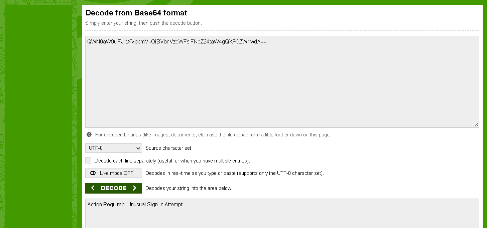
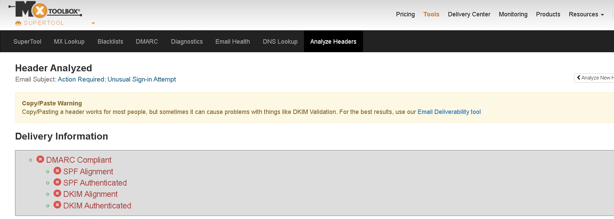

# 🎣 Phishing Email Analysis & Triage Lab

> **SOC Analyst Level 1 | Incident Response | Threat Analysis**

## 📌 Project Overview

This project demonstrates a professional phishing email investigation following the **SOC Tier 1 Triage Workflow**. The objective was to analyze a suspicious email, extract Indicators of Compromise (IOCs), and provide actionable containment recommendations — all without opening the email or clicking any links.

**Why a sanitized lab sample instead of a real email?**
> In production environments, major email providers (Gmail, Outlook) often modify headers, strip attachments, or neutralize links for user protection. This can destroy the raw forensic evidence needed for deep analysis. Using a controlled, sanitized sample ensures complete access to the original headers, authentication results, and obfuscation techniques — proving the ability to analyze emails at the protocol level, not just the UI level.

---

## 🧠 Methodology: The 5 Ws Framework

Every investigation follows the **5 Ws** methodology to ensure completeness and consistency:

| Question | Focus |
|----------|-------|
| **Who** | Target user / affected account |
| **What** | Attack type and technique |
| **When** | Timestamp of the event |
| **Where** | Origin (Return-Path) and destination (malicious URL) |
| **Why/How** | Technical IOCs and attacker TTPs |

---

## 🔍 Triage Report

### 👤 Who (Target)
- **Targeted User:** `j.mahmoud@company.example`
- **Department:** Likely general staff (targeted via generic "Microsoft 365 Security" branding)

### ⚠️ What (Attack Type)
- **Classification:** Credential Harvesting / Phishing Attack
- **Technique:** Social engineering + Typosquatting + Header spoofing
- **MITRE ATT&CK Mapping:**
  - **T1566.002** – Phishing: Spearphishing Link
  - **T1027** – Obfuscated Files or Information (Base64-encoded subject)

### 🕐 When (Timestamp)
- **Email Date Header:** `Mon, 23 Nov 2026 01:14:19 +0000`
- **Received by Mail Server:** `Mon, 23 Nov 2026 03:14:22 +0200`
- **Time Delta:** ~2 hours (consistent with international relay)

### 📍 Where (Origin & Destination)
| Field | Value | Analysis |
|-------|-------|----------|
| **From (Displayed)** | `no-reply@microsoft.com` | ❌ Spoofed — impersonating Microsoft |
| **Return-Path (Actual Sender)** | `bounce@mail-relay-392.example` | 🔴 Real origin — does NOT match From |
| **Reply-To** | `security-verify@rnicrosoft-secure.example` | 🔴 Typosquatting domain (`rn` ≈ `m`) |
| **Message-ID Domain** | `rnicrosoft-secure.example` | 🔴 Confirms attacker-controlled infrastructure |

### 🧬 Why/How (Technical IOCs)

Three decisive technical indicators confirm this is a malicious phishing attempt:

1. **Authentication Failure (SPF/DKIM/DMARC):**
   - `SPF = fail` (sender IP `203.0.113.45` not authorized)
   - `DKIM = none` (message not signed)
   - `DMARC = fail` with action `quarantine`
   - **Conclusion:** Sender has no legitimate relationship with `microsoft.com`.

2. **Typosquatting / Homoglyph Attack:**
   - Attacker domain: `rnicrosoft-secure.example`
   - Uses `r` + `n` to visually mimic `m` in `microsoft`
   - Classic technique to bypass casual user inspection.

3. **Subject Line Obfuscation (Base64 Encoding):**
   - Raw: `=?UTF-8?B?QWN0aW9uIFJlcXVpcmVkOiBVbnVzdWFsIFNpZ24taW4gQXR0ZW1wdA==?=`
   - Decoded: **"Action Required: Unusual Sign-in Attempt"**
   - **Purpose:** Evade keyword-based email gateway filters (MITRE T1027).

---

## 🛡️ Recommended Actions (Containment Plan)

As a Tier 1 SOC Analyst, the following actions are recommended:

### 🔴 Immediate (Within 15 minutes)
1. **Block at Perimeter:** Add `rnicrosoft-secure.example` and IP `203.0.113.45` to the email gateway and firewall blocklists.
2. **Global Email Purge:** Execute a Hard Delete of this message (by Message-ID `8f2a1c44b1@rnicrosoft-secure.example`) from all user mailboxes.

### 🟡 Short-term (Within 1 hour)
3. **User Contact:** Reach out to `j.mahmoud` to confirm:
   - Did they click the link?
   - Did they enter credentials?
   - If YES → escalate to Tier 2 for credential reset and endpoint scan.
4. **Threat Intel Enrichment:** Submit IOCs to VirusTotal, URLScan.io, and internal threat intel platform.

### 🟢 Long-term (Within 24 hours)
5. **Rule Tuning:** Create a SIEM correlation rule to detect future emails with:
   - `SPF=fail` + `DMARC=fail` + external sender
   - Subject lines containing Base64-encoded content
6. **User Awareness:** Send a targeted awareness notification about typosquatting techniques.

---

## 🧰 Tools Used

| Tool | Purpose |
|------|---------|
| **Base64 Decoder** (`base64decode.org`) | Decode obfuscated subject line |
| **MXToolbox Header Analyzer** | Parse email headers and authentication results |
| **URLScan.io** | Safe analysis of malicious URLs (defanged) |
| **VirusTotal** | Hash reputation check for attachments |

---

## 📸 Evidence Screenshots

*Figure 1: Decoding the obfuscated Base64 subject line — revealing the true intent.*

*Figure 2: MXToolbox header analysis — all authentication mechanisms failed (SPF, DKIM, DMARC).*

> ⚠️ Note: The MXToolbox "Copy/Paste Warning" is expected in lab environments. DKIM validation relies on raw byte-level integrity, which can be altered during manual header extraction. In production, headers are pulled directly from the Email Gateway or via `Show Original` to preserve signature integrity.
---

## 🎓 Key Learnings

1. **Never trust the `From` field** — always verify `Return-Path` and `Received` headers.
2. **Authentication failures are strong indicators** — `SPF=fail` + `DMARC=fail` is a near-certain sign of spoofing.
3. **Obfuscation is a red flag** — Base64-encoded subjects are rarely used in legitimate business emails.
4. **User statements are hypotheses, not evidence** — always verify technically before closing a ticket.

---

## 📚 References

- [MITRE ATT&CK — Phishing (T1566)](https://attack.mitre.org/techniques/T1566/)
- [OWASP — Phishing Cheat Sheet](https://cheatsheetseries.owasp.org/cheatsheets/Phishing_Prevention_Cheat_Sheet.html)
- [RFC 822 — Email Header Standards](https://tools.ietf.org/html/rfc822)

---

**Built by:** Jamal | SOC Analyst Level 1 Candidate  
**Date:** November 2026  
**Status:** ✅ Complete
